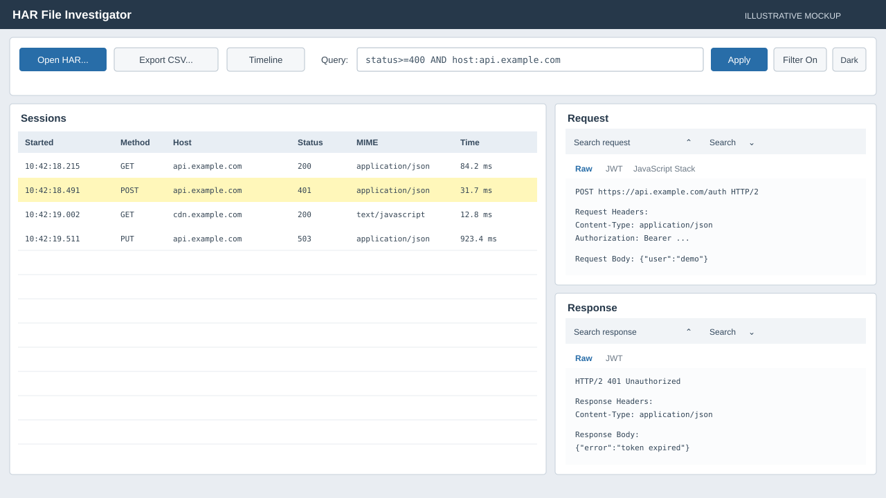
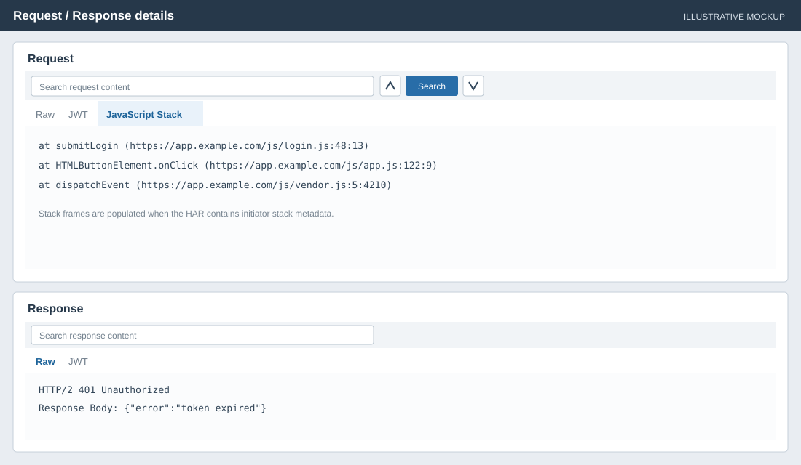
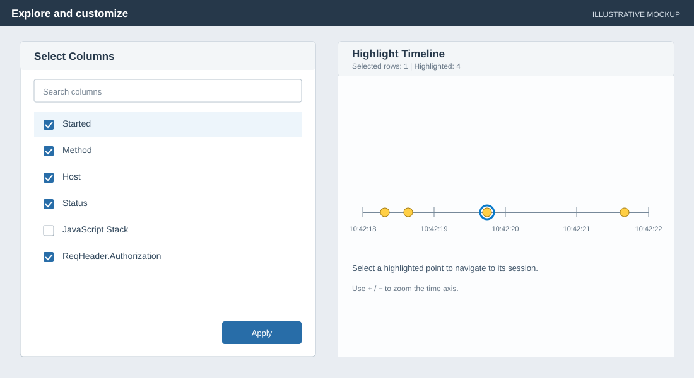

# HAR File Investigator

A Windows desktop application for inspecting HTTP Archive (`.har`) files. Browse request/response entries, search and filter traffic, inspect request and response contents, and organize findings with tags.

> **Screenshots:** The images below are illustrative SVG mockups of the application workflows, not captures of the running application.

## Screenshots

### Main window



### Request and response inspection



### Column selection and timeline



## Features

- **Load HAR files:** Open `.har` or JSON files and browse the entries in a sortable, selectable grid.
- **Inspect traffic:** View request and response headers and bodies, decoded JWT views, and JavaScript stack frames when stack information is present in the HAR entry. The request/response pane can be torn out into a separate window and docked back.
- **Search request and response content:** Search the currently selected Raw, JWT, or JavaScript Stack view with Search, Previous, and Next controls.
- **Query traffic:** Search all entry text or use field-based expressions, Boolean operators, parentheses, and negation. Matching entries are highlighted; the Filter toggle controls whether nonmatching rows are hidden.
- **Choose visible columns:** Right-click a grid column header to open the searchable checkbox dialog. Select built-in or HAR-specific fields to show in the grid.
- **Tag entries:** Add tags to highlighted results, manage tag colors, and save tags back into a HAR file.
- **Explore highlighted entries:** Open the timeline to view highlighted requests by time, zoom, and select entries from timeline points.
- **Export:** Export the currently displayed/filtered rows to CSV.
- **Theme and preferences:** Switch between light and dark themes. UI preferences and query history are stored under the current user's local application data.

## Query syntax

Queries are case-insensitive. Adjacent terms are combined with implicit `AND`. Use `AND`, `OR`, parentheses, and `!` to combine or negate terms. Quoted text searches for a phrase.

| Expression | Meaning |
| --- | --- |
| `timeout` | Find entries whose searchable text contains `timeout`. |
| `method:POST` | Find requests whose method contains `POST`. |
| `host=api.example.com` | Match the host exactly. |
| `status>=400` | Match a numeric status comparison. |
| `time<250` | Match a duration in milliseconds below 250. |
| `request:"Bearer token"` | Search request content for the phrase. |
| `method:GET AND status>=400` | Require both conditions. |
| `host:api.example.com OR host:cdn.example.com` | Match either host condition. |
| `!(status=200 OR status=204)` | Exclude successful status codes 200 and 204. |

Supported built-in fields include `method`, `host`, `url`, `status`, `mime`/`mimetype`, `time`/`duration`, `ip`, `tag`/`tags`, `request`, `response`, and `text`. Additional HAR entry fields can also be queried by field name when available. String fields support `:` for contains, `=` for equality, and `!=` for inequality. Numeric `status`, `time`, and `duration` comparisons support `=`, `!=`, `<`, `<=`, `>`, and `>=`.

## Getting started

### Requirements

- Windows
- .NET 8 SDK (for building and running from source)

### Run from source

```powershell
dotnet build HARFileInvestigator.sln
dotnet run --project HARFileInvestigator/HARFileInvestigator.csproj
```

1. Select **Open HAR...** and choose a HAR or JSON file.
2. Select an entry in the grid to display its request and response details.
3. Enter a query and select **Apply** to highlight matches. Turn **Filter** on to show only matching entries.
4. Right-click a column header to choose which columns are visible.
5. Use **Tag**, **Timeline**, or **Export CSV...** to work with the matching entries.

## Notes

- JavaScript stack information is optional and depends on the HAR producer. The stack tab is blank when an entry does not contain supported stack metadata.
- Saving writes the current entry tags back to a HAR file; it does not rewrite the original file unless you choose that same path in the Save dialog.
- The screenshots are explanatory mockups and may not exactly match the current app layout or operating-system theme.
